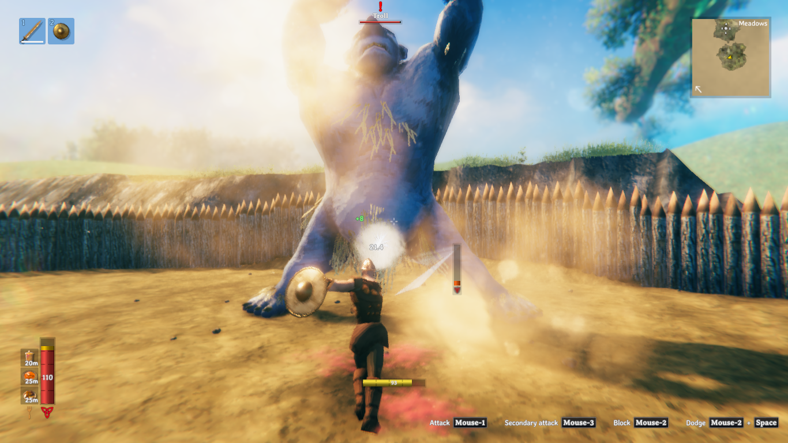
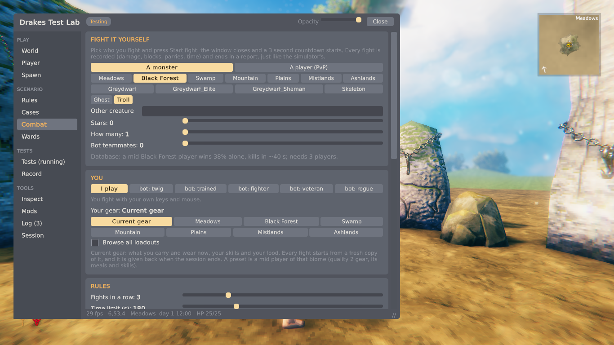
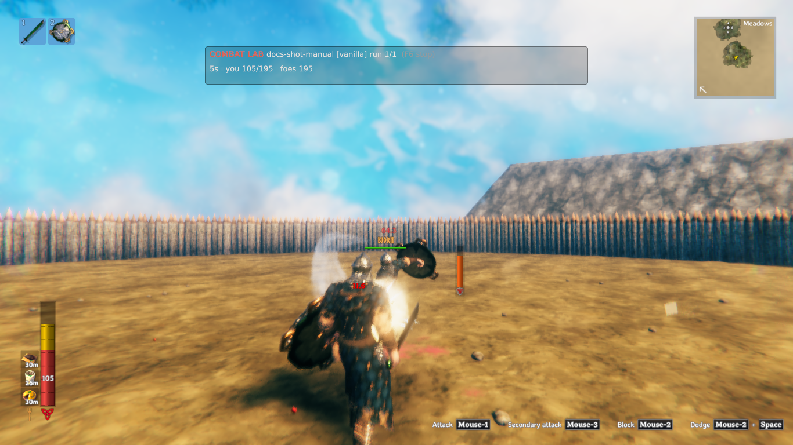
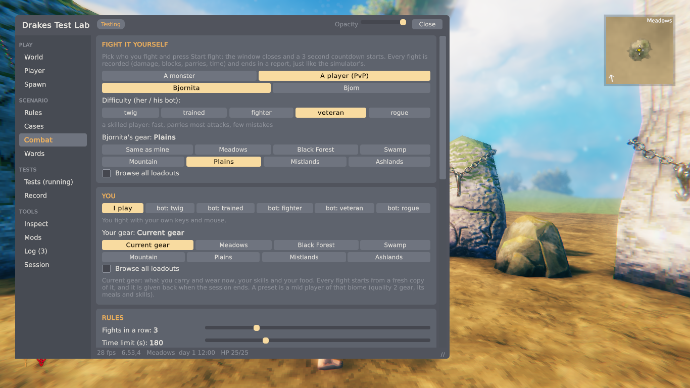
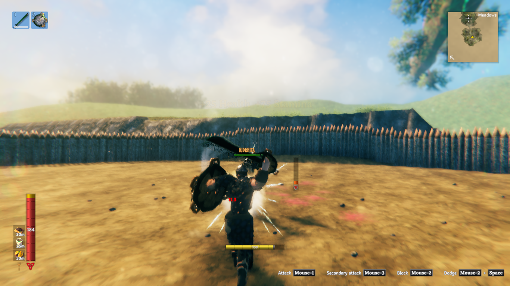
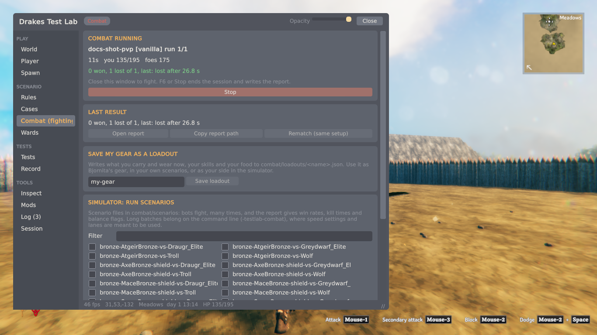
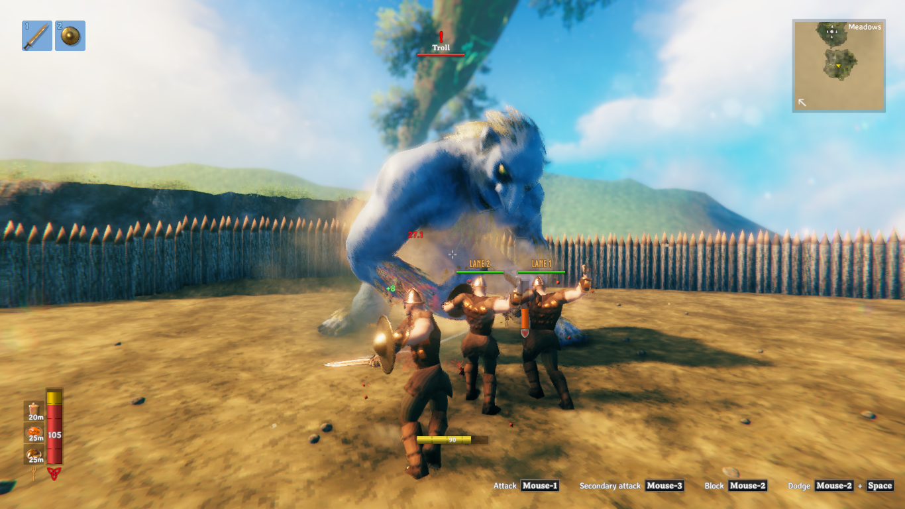

# Combat Lab

Combat Lab is DrakesTestLab's balance simulator. It answers questions like "is my bronze sword stronger than vanilla's?",
"how many players does a 1-star Troll need?" or "does my armour mod make the Plains too easy?" with real fights:
monsters use the game's own AI and attacks, and the player's side is played by a bot (or by you). Each setup is fought
many times, because Valheim rolls damage on every swing, and the report gives averages with honest error bars.

There are two ways to use it:

| | Live fights (Combat tab) | Simulator (scenario files) |
|---|---|---|
| Who plays you | you, or a bot you watch | a bot |
| Speed | normal (1x) | 1x to 4x, up to 4 fights side by side |
| Typical use | try a build by hand, PvP against Bjornita or Bjorn, check a monster feels right | measure win rates, kill times, players needed, compare mod versions |
| Results | the same report (`combat/results/latest.html`) | the same report, plus the difficulty database |

Everything lives in `BepInEx/config/DrakesTestLab/combat/`:

```
combat/
  loadouts/          gear sets (weapon, armour, food, skills)
  scenarios/         fights to run (who against what, how many times, which rules)
  baselines/         old result files every new report is compared with (optional)
  results/           latest.html, latest.json, run-<date>/, shots/
  difficulty-db.json the whole-game difficulty baseline
```

Shipped loadouts and scenarios are copied in on first use and never overwrite your edits. Delete a file to get the
shipped one back.



---

## 1. Live fights: the Combat tab

Press **F9**, open **Scenario > Combat**.



**Fight it yourself**

1. Pick **A monster** or **A player (PvP)**.
   - Monster: choose a biome, click a creature (or type another one's prefab name), set its **stars** (0 to 2) and
     **how many**. **Bot teammates** (0 to 3) adds bot players in your gear beside you; pick how well they play.
     The line under it is the difficulty database's answer for that creature: how often a mid player of the biome
     wins alone, how fast, and how many players it needs.
   - Player: choose **Bjornita** or **Bjorn**, their **difficulty** (the bot that plays them, see below) and their
     **gear**: the same as yours, a biome preset, or any loadout.
2. **You**: *I play* (your keys and mouse) or a bot (to watch). **Your gear**: *Current gear* (what you have on, your
   skills and food), a biome preset (a mid player of that biome), or any loadout.
3. **Rules**: how many fights in a row, the time limit per fight, and the **player-count scaling** (see below).
4. **Start fight**. The window closes, you are taken to the combat arena, a 3 second countdown runs, then the foe
   comes. The red **COMBAT LAB** banner shows the fight time, both sides' health and the running tally.



Each fight starts from the same state: you are reset, given the gear fresh, fed, healed, and put at the start spot.
A death is recorded, not played out (no tombstone; see `[Combat] SkipDeathReload`). When the session ends (all
fights done, **Stop**, or the stop key, F6 by default) the report is written and your own gear, skills and food are
given back.





While a session runs, the tab shows its status, the tally and a **Stop** button:



**Last result**: the tally, **Open report**, and **Rematch** (the same setup again).

**Save my gear as a loadout** writes what you carry and wear, your skills and your food to
`combat/loadouts/<name>.json`. Use it as Bjornita's gear, as your side in a scenario, or share it.

**Simulator: run scenarios** lists the scenario files; tick some and press Run. Long batches are better started from
the command line (section 5), where the game can close itself when done.

### Bots: the difficulty levels

| Bot | Plays like |
|---|---|
| `twig` | a new player: slow to react, rarely blocks, never rolls |
| `trained` | a button masher with a shield: blocks about half the hits, rolls a little |
| `fighter` | a decent player: parries, rolls, backs off to recover stamina, punishes staggers, makes human mistakes |
| `veteran` | a skilled player: fast, parries most attacks, few mistakes |
| `rogue` | a stealth build: sneaks up for a backstab, then hit and run with rolls instead of blocks |
| `you` | nobody: you play (live fights) |

The fighter and veteran bots read the foe's attack, parry with Valheim's own parry window, roll when blocking fails,
learn which attacks they cannot block, strafe between combos, and sometimes miss a swing or react late, like people
do. All bots use the game's own attack, block and dodge code, so a mod that changes those changes the bot's fight too.

### Player-count scaling

Valheim makes a monster tougher for every player within 200 m (more health and more damage). The lab controls it:

| Setting | What the monster scales for |
|---|---|
| **Auto** (default) | the players really fighting it: you plus your bot teammates. Side-by-side lanes count 1 each. PvP: 1. |
| **Vanilla** | whatever the game counts itself: every player nearby, as in normal play (lanes then make every monster a group monster) |
| **Off** | always one player: a solo-strength monster even when a team fights it |
| **As 2 / 3 / 4** (any number in a scenario) | that many players, whoever fights it: one player against a 3-player Troll |

In a scenario file this is `"playerScaling": "auto" | "vanilla" | "off" | 3`.

---

## 2. Loadouts

A loadout is the gear side's kit: `combat/loadouts/<name>.json`.

```json
{
  "name": "my-iron-build",
  "tier": "swamp",
  "items": [
    { "prefab": "SwordIron", "quality": 2 },
    { "prefab": "ShieldBanded", "quality": 2 },
    { "prefab": "ArmorIronChest", "quality": 2 },
    { "prefab": "ArmorIronLegs", "quality": 2 },
    { "prefab": "HelmetIron", "quality": 2 },
    { "prefab": "MeadHealthMedium", "count": 3, "equip": false }
  ],
  "meals": [ "Sausages", "TurnipStew", "BlackSoup" ],
  "skills": { "Swords": 30, "Blocking": 25 }
}
```

| Key | Meaning |
|---|---|
| `items` | prefab names. `quality` 1 to 4, `count` for stacks, `equip: false` to only carry it. A plain string is one item, equipped. |
| `meals` | up to 3 food prefabs, eaten fresh before every fight. Health, stamina, regen and food decay then come from the game's own food code. |
| `food` | named food profiles instead: `{ "health": [..meals..], "balanced": [..] }` or fixed numbers `{ "tank": { "health": 150, "stamina": 80 } }`. A scenario picks them with `"food": ["health", "balanced"]`. |
| `skills` | skill name to level (`Swords`, `Axes`, `Clubs`, `Spears`, `Polearms`, `Knives`, `Blocking`, `Sneak`, `Run`, `Jump`...). |
| `tier` | used when `skills` is empty: every skill starts at the tier's level (`[Combat] TierSkills`: meadows 1, blackforest 15, swamp 25, mountain 35, plains 45, mistlands 55, ashlands 65), and the weapon skill and Blocking move 5 per weapon quality above or below 2. |
| `maxHealth`, `maxStamina` | fixed numbers instead of meals (older style). |

Shipped loadouts:
- `game-<biome>-mid`: the difficulty database's player, a mid player of each biome (quality 2 gear of the tier, its meals, tier skills).
- `cal-<biome>-<weapon>`: the calibration builds (sword, axe, mace, spear, atgeir, a stealth knife build...), some at other qualities (`-q1` to `-q4`).
- `bronze-*`, `iron-*`, `mb-*`: weapon baselines of those tiers.

A loadout that cannot fully equip voids the fight (nothing is recorded) rather than counting as a loss.

---

## 3. Scenarios

A scenario is one experiment: `combat/scenarios/<name>.json`. The smallest one:

```json
{ "name": "troll-test", "gear": { "loadout": "game-blackforest-mid" }, "foes": { "prefab": "Troll" } }
```

That runs 20 fights of the `trained` bot against a Troll at normal speed. Everything else is optional.

### Who fights

| Key | Meaning |
|---|---|
| `gear.loadout` | the player's loadout (required) |
| `bot` | who plays the player: `twig`, `trained` (default), `fighter`, `veteran`, `rogue`, `you` |
| `foes` | one foe `{ "prefab": "Troll", "stars": 1, "count": 2, "distance": 12 }` or a list of them |
| `pvp` | instead of foes: `{ "loadout": "game-plains-mid", "bot": "veteran", "name": "Bjornita" }` (`name` Bjornita or Bjorn) |
| `team` | team fight: `2` (that size), or a climb `{ "from": 1, "to": 4, "needWin": 0.5 }`: sizes go up until a team wins at least `needWin` of its fights. The report says "players needed". |
| `allyBot` | the teammates' bot (default: the scenario's `bot`) |
| `calibrate` | how many foes at once: `{ "from": 2, "to": 8, "step": 1, "stopBelow": 0.2, "capacityAt": 0.5 }`. The report says "can handle N". |
| `opener` | `"sneak"`: foes start facing away and unaware, so a stealth build can open with a backstab |



### How many, how long

| Key | Default | Meaning |
|---|---|---|
| `runs` | 20 | fights per cell (with `autoRuns`, the cap) |
| `autoRuns` | `[Combat] AutoRuns` (on) | stop early once the numbers are settled: at least 3 fights, the win rate known to within 30 points (or 5 unanimous fights), and the fight time and damage taken known to within 10% |
| `timeout` | 60 | fight time limit in seconds; a fight that reaches it is a timeout |
| `stall` | 15 | seconds without any damage before the fighters are moved to a fresh spot (`unsticks` times, default 2); after that the fight is "stalled". 0 = off. |
| `seed` | 1 | the bots' random seed (results are statistical, not repeatable fight for fight) |
| `foeEndHealth`, `gearEndHealth` | 0 | end a fight early when the foes' (or the player's) health falls to this fraction |
| `countdown` | 0 | seconds of countdown before the foes come |

Stalled and timed-out fights are not wins or losses: they are reported, and left out of the win rate.

### Speed: clock and lanes

| Key | Default | Meaning |
|---|---|---|
| `timeScale` | `[Combat] TimeScale` (1) | game clock speed, 1 to 4. Everything (damage rolls, AI, the bot) runs on game time. |
| `lanes` | 1 | fights side by side (up to 4), each in its own zone of the arena with its own foes; one fight gives that many results |
| `lanes` (a list) | | mixed lanes: `[ { "loadout": "...", "bot": "...", "foes": ..., "label": "..." }, ... ]`; each setup gets its own result row, setups rotate between lanes every fight |
| `laneLock` | true | each lane's foes only target their own lane's player |
| `laneKeep` | true | fighters that leave their zone are put back in it |
| `lean` | `[Combat] Lean` | draw nothing during fights (faster on a small GPU) |

**Validated speed-ups.** Against normal play (one fight at a time, 1x), **3 lanes at 3x** matched on win rate, kill
time and time to die for Greydwarf Elite and Troll. Damage taken reads about 3% low in lanes and about 11% low at 3x,
so treat damage-taken numbers from fast runs as slightly optimistic. Faster clocks depend on frame rate (the
validation ran at about 40 fps); on a slow PC use 2x. Lanes work because the lab tells the game each lane is one
player (see player-count scaling): with `"playerScaling": "vanilla"` every lane's monster would scale for all lanes.

### Rules (raw-data switches, all off by default = real Valheim)

| Key | Meaning |
|---|---|
| `playerScaling` | `auto`, `vanilla`, `off`, or a number (section 1) |
| `fearless` | foes never flee |
| `aggro` | foes hunt the player at once, even passive ones |
| `noStagger` | `none`, `foes`, `gear` or `all` |
| `noKnockback` | no knockback |
| `foeDamage`, `gearDamage` | multipliers on what each side deals |
| `attack` | `primary` (default), `secondary`, `mix` (alternate), `mix:every3`, `mix:4s`; a list runs each |
| `food` | food profile names from the loadout; a list runs each |

### Comparing: variants, bands, baselines

- **Variants** run the same fights with config changes, in the same game:

  ```json
  "variants": [ "vanilla",
    { "name": "double-damage", "configOverrides": [ { "guid": "com.example.mymod", "section": "Balance", "key": "DamageMultiplier", "value": "2" } ] } ]
  ```

  The report's **Compare variants** view counts a change only when the 95% intervals do not overlap.
- **Bands** say what you expect: `"band": { "winMin": 0.6, "winMax": 0.95, "ttkMin": 8, "ttkMax": 25 }`. Each cell
  gets a verdict, colour and symbol: normal (green, check), slightly off (yellow, `+` too strong / `-` too weak; within
  10 win points or 25% of the time bound), far off (red, `++` / `--`). Far-off cells make the run exit with code 1.
- **Baselines**: copy a clean run's `combat.json` into `combat/baselines/<name>.json`. Every later report lines its
  cells up against the baseline's matching cells (as a variant called `baseline: <name>`). Use it to compare a mod
  against vanilla, which cannot run in the same game.

### Pictures

`"screenshots": [ { "at": 5, "name": "my-fight", "tab": "Combat", "clean": true, "run": 1 } ]` saves
`combat/results/shots/my-fight.png` 5 seconds into fight 1 (`run: 0` = every fight, numbered). `tab` opens the
toolbox on that tab for the picture; `clean` hides the banner.

### Examples that ship

| Scenario | Shows |
|---|---|
| `example-troll-solo` | the basics: a mid Black Forest player vs a Troll |
| `example-troll-players-needed` | a team climb 1 to 4 |
| `example-troll-scaled-for-3` | one player vs a Troll scaled for 3 |
| `example-team-no-scaling` | three players vs a solo-strength Troll |
| `example-fast-lanes` | 3 lanes at 3x |
| `example-mixed-lanes` | sword, axe and mace side by side |
| `example-bot-skill` | twig, fighter and veteran side by side |
| `example-band` | a balance band and its verdict |
| `example-horde` | how many Greydwarfs at once |
| `example-variants` | a config variant (edit the guid to your mod's) |
| `pvp-plains-vs-bjornita-<bot>` | PvP presets: Bjornita at every difficulty |
| `pvp-mistlands-vs-bjorn-plains` | PvP across tiers |
| `game-<biome>-<foe>-<n>star` | the difficulty database's climbs |
| `cal-<biome>-<foe>-<attack>` | the calibration fights the model is built from |

---

## 4. The report

`combat/results/latest.html` (and `run-<date>/combat.html`), plus `latest.json` for scripts.

- **Win rate and time to kill**: rows are loadouts, columns foes; each cell shows wins, the 95% range, the median
  kill time and the verdict colour when there is a band.
- **How many can they fight at once / players needed**: calibration and team climbs.
- **Compare variants**: bars with 95% intervals; "clear change" only when the intervals do not overlap.
- **Sampled fights**: one typical fight per cell, hit by hit (time, attacker, raw and final damage by type, blocks,
  parries, backstabs, health after).

Every result records the mods and versions loaded, so two reports from different setups are never mixed silently.
A report is saved after every finished cell, so a crash keeps what ran.

---

## 5. Command line and scripts

```
valheim.exe -testlab-combat example-troll-solo,example-fast-lanes
valheim.exe -testlab-combat "game-plains-*" -testlab-combat-runs 10
```

| Switch | Meaning |
|---|---|
| `-testlab-combat <names>` | run scenarios: names separated by commas, `all`, or prefixes ending in `*`. The game closes when done: exit 0 fine, 1 a far-off balance flag, 3 nothing ran. |
| `-testlab-combat-runs N` | override every scenario's `runs` |
| `-testlab-combat-check` | only check that every item, meal and creature named exists; no fights |
| `-testlab-combat-dump` | write the game's combat numbers (weapons, armour, creatures) to `combat/gamedata.json` |
| `-testlab-stay` | keep the game open afterwards |

The runner scripts take the same: `Run-TestLabSuites.ps1 -Combat example-troll-solo -Runs 10`,
`run_testlab_suites.py --combat example-troll-solo --runs 10 [--combat-check] [--combat-dump]`. In hot mode, put
the scenario list in `config/DrakesTestLab/requests/combat.txt`.

### Config (`[Combat]`)

| Key | Default | Meaning |
|---|---|---|
| `ArenaRadius` | 26 | radius of the flat, cleared, staked fighting ground (20 to 30) |
| `TimeScale` | 1 | game clock during fights (1 to 4); a scenario's `timeScale` overrides it |
| `Lean` | false | draw nothing during fights |
| `AutoRuns` | true | stop a cell early once its numbers are settled |
| `TierSkills` | meadows=1 ... deepnorth=75 | skill level per tier for loadouts without skills |
| `SkillPerQuality` | 5 | weapon skill points per weapon quality above or below 2 |
| `MaxFightSeconds` | 300 | real-time cap per fight |
| `MaxRunMinutes` | 240 | real-time cap per run (0 = none) |
| `SkipDeathReload` | true | record deaths instead of playing them out |

---

## 6. The difficulty database

`combat/difficulty-db.json` answers, for every creature of every biome at 0, 1 and 2 stars: how does a mid player of
that biome do alone (win rate, kill time, damage taken, per weapon build), and how many such players does it take to
win at least half the time. The Combat tab shows it under the monster picker.

The shipped file has 96 rows: 82 from real fights and 14 filled in by a model fitted to those fights. Each row says
which (`"source": "fought"` or `"model"`).

How it was made (it takes hours, so it ships ready):
1. **Calibration**: every creature fought by the tier's builds (sword, axe, mace, spear, atgeir, stealth knife) in
   3 lanes at 3x: `-testlab-combat "cal-*"`.
2. **Model** (`tools/combat_predict.py`): win chance from how long the player lasts against how long the kill takes,
   with each creature's measured star effect, fitted to the calibration.
3. **Spot-checks**: 36 random weapon x quality x star combinations the model had never seen were fought; it predicted
   34 of them.
4. **Team effect**, fitted on the fought team climbs. Extra players help much less than Valheim's health and damage
   scaling suggests: a second or third player adds about a sixth of what the scaling would predict.
5. **Build** (`tools/combat_build_db.py`): fought cells win; the model fills the rest.

Your own `"difficulty": true` scenarios (the `game-*` climbs) write rows into your copy of the database; a row you
fought replaces the shipped one, the others stay.

Read the numbers as difficulty levels: a cell has about 8 fights, so 4 of 8 means "somewhere around 20% to 80%". For a
small balance change, run your own scenario with 30 or more fights.

---

## 7. Limits

- Melee only: bows, staffs and magic are not played by the bots yet.
- Bosses are not in the database.
- Stars above 2 need a creature level mod; not supported yet.
- Results are statistical: the same scenario twice gives close, not identical, numbers.
- Mods that set things up only at world start (new items, ServerSync settings) may need a restart between variants.
